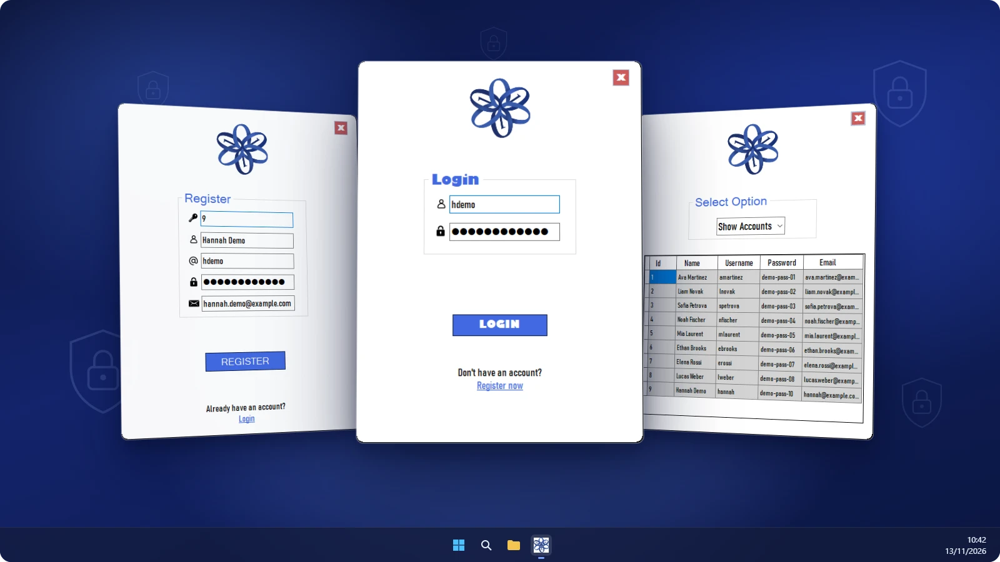
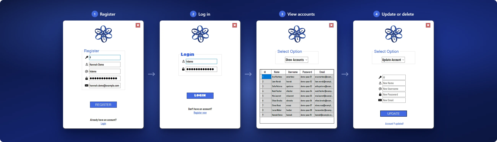

<div align="center">

# SimpleLoginSystem

**A compact Windows desktop account manager, from registration to CRUD.**

   

[Screenshots](#screenshots) · [Getting started](#getting-started)



</div>

## Overview

SimpleLoginSystem demonstrates a complete desktop account workflow: register, sign in, list accounts, update their details and delete records. The interface uses Windows Forms, with separate presentation, business-logic and data-access projects.

Accounts are stored in a local CSV file. This is a learning project for desktop forms and layered CRUD; passwords are stored in plain text and visible in the account grid, so use **demo credentials only**.

## Features

| Account flow | Implementation |
| --- | --- |
| **Registration and sign-in forms** | **Three-layer structure**: PL → BLL → DAL |
| **Account listing, updates and deletion** | **CSV-backed persistence**, with no database server |
| **Logout and navigation** between forms | **Controllers, services and repository classes** |

## Screenshots



The blue desktop composition contains real application screenshots. All displayed identities and passwords are demo data.

## Getting started

Requires **Windows**, a .NET SDK that can build `net7.0-windows`, and the **.NET 7 Windows Desktop Runtime** to launch the default build. Visual Studio 2022 with the **.NET desktop development** workload can also open the solution.

Run these commands in PowerShell from a fresh clone:

```powershell
git clone https://github.com/HHChandar20/SimpleLoginSystem.git
cd SimpleLoginSystem
dotnet restore .\SimpleLoginSystem\SimpleLoginSystem.sln
dotnet build .\SimpleLoginSystem\SimpleLoginSystem.sln --configuration Debug
cd .\SimpleLoginSystem\SimpleLoginSystem.PL\bin\Debug\net7.0-windows
.\SimpleLoginSystem.PL.exe
```

The final `cd` matters: the repository resolves `MOCK_DATA.csv` relative to the process working directory. Running `dotnet run` from the repository root does not preserve that expected layout.

Use a separate clone for experiments because registration, updates and deletion write directly to `SimpleLoginSystem.DAL/Data/MOCK_DATA.csv`. The account CSV contains five comma-separated fields in this order: `id,name,username,password,email`.

A build of the isolated demo copy was verified with the .NET 9 SDK. The project still targets .NET 7, and the SDK reports that target as out of support.

## Tech stack

C# · .NET 7 · Windows Forms · Local CSV files

## License

[MIT](LICENSE).

Built by [Hakan Chandar](https://github.com/HHChandar20) · 2023.
